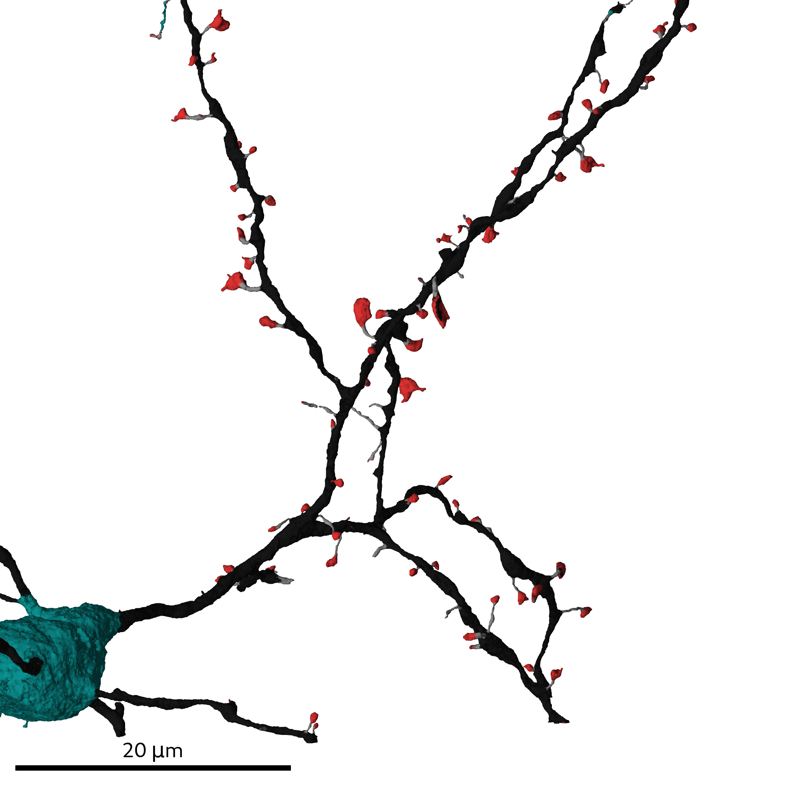
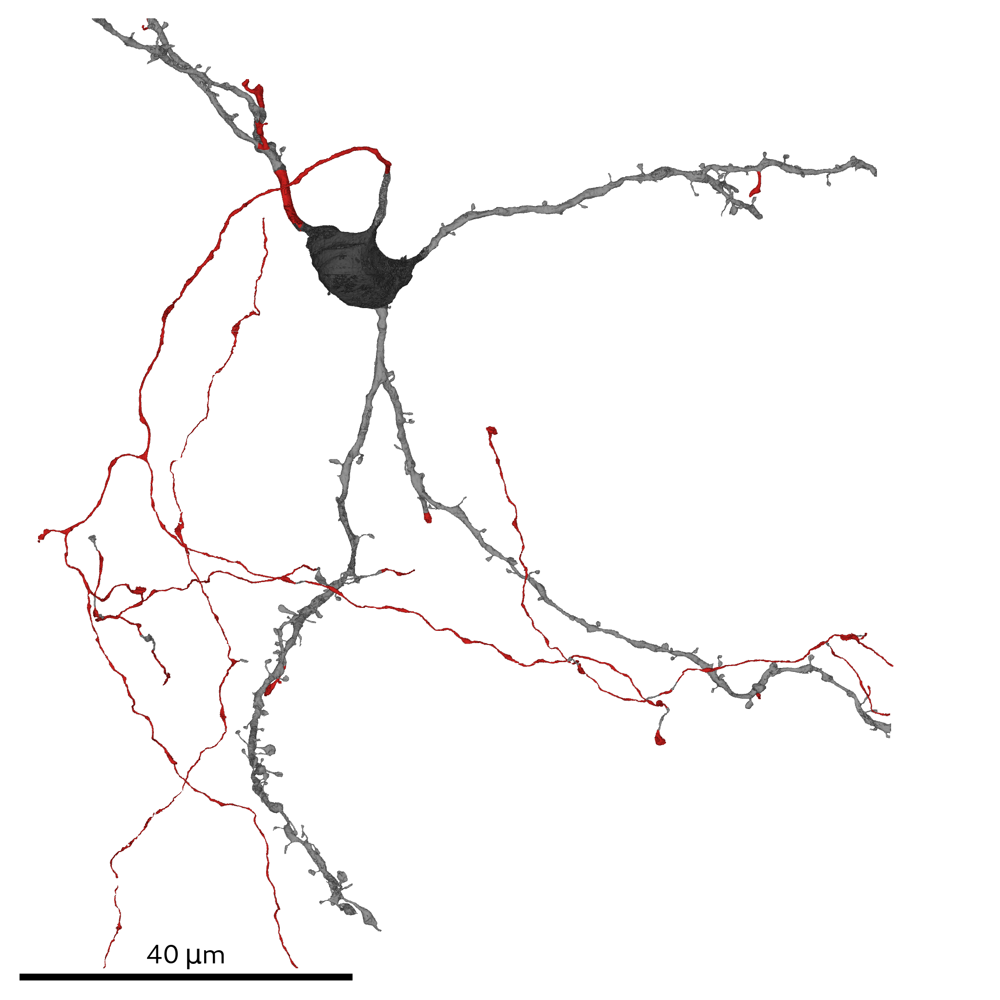

# Neuronal morphology analysis and classification
All scripts used for the analysis of the neuron segmentation are located in `SyConn/scripts/multiviews_neuron/`, namely:
* SSV multi-views generation: `start_sso_rendering.py`
* Cell compartment prediction: `axoness_prediction.py` and `spiness_prediction.py`
* Cell type prediction: `celltype_prediction.py`

## Prerequisites
* Knossos- and SegmentationDataset of the supervoxel segmentation
* SegmentationDatasets for all cellular organelles (currently mitochondria, vesicle clouds and synaptic junctions)
* \[Optional\] [Glia removal](glia_removal.md)
* The RAG/SV-mapping in form of a SSD, see [SuperSegmentationDatasets](super_segmentation_datasets.md)
* [Mapped cellular organelles](object_mapping.md) to SSVs

## Steps

The multi-views contain shape information of cellular organelles and the cell/SSV outline
and are the basis for predicting cell compartments, cell type and spines. To generate them dataset-wide run:

    start_sso_rendering.py

Dataset-wide predictions can be started via the respective scripts:
* Cell compartments: `axoness_prediction.py` and `spiness_prediction.py`
* Cell types: `celltype_prediction.py`

Their results are stored on SSV level and used for [extracting the wiring diagram](contact_site_classification.md) later on.

## Point cloud based cell type classification (Point Transformer V3)
`syconn/cnn/ptv3/` contains a vendored Point Transformer V3 (Pointcept, MIT license) with a cell type head
(`celltype.py`), an exact submanifold convolution for batch-independent inference (`subm.py`) and a lean inference
loader for SSVs (`ctinfer.py`). The model is trained on the hybrid point clouds of the ground truth cells
(`SYCONN_CT_GT_CSV`, `SYCONN_CT_HC_DIR`; k-fold split with `SYCONN_CT_NFOLDS`) and applied dataset-wide:

    python syconn/cnn/cnn_celltype_ptv3_j0251.py --sr <run dir> --cval <fold or -1 for all GT> --num_classes <C>
    python syconn/exec/exec_celltype_ptv3_inference.py --ids <npy with SSV ids> --out <part.npz> --ckpt <state dict> --num_classes <C>
    python syconn/exec/exec_celltype_ptv3_merge.py --wd <working dir> --parts "<part*.npz>" --out <array dir> --key celltype_pts_<name> --temperature <T>

The merge script writes the per-SSV class, certainty (entropy of the temperature-scaled mean softmax over the
`redundancy` contexts) and logits as arrays aligned with `ssv_0/id.npy`.
